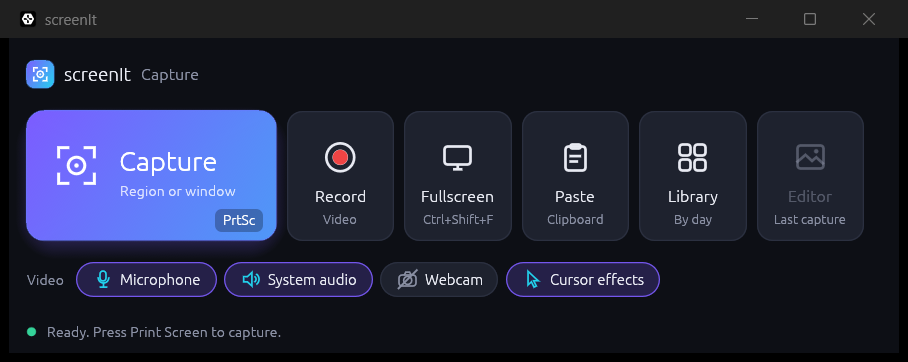
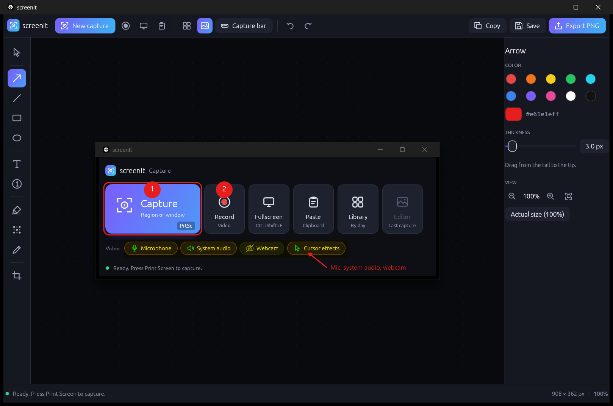
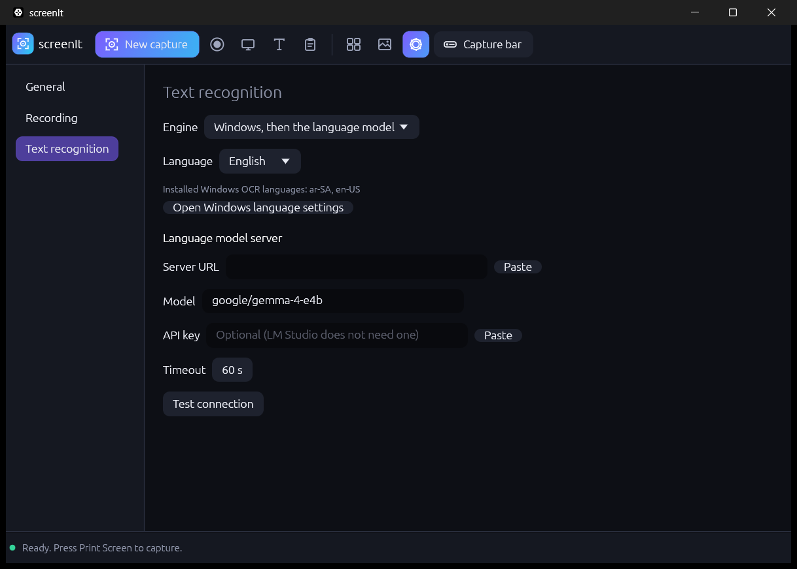
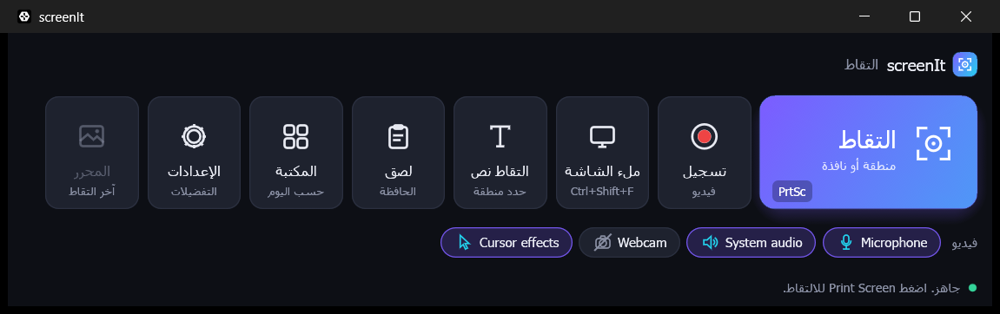
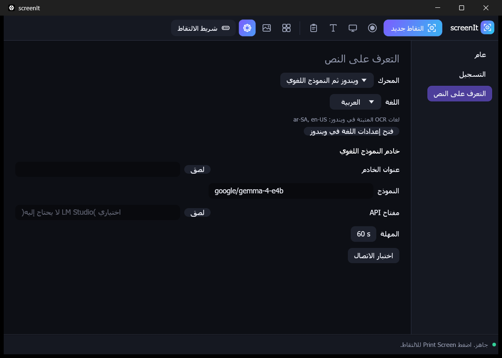

<div align="center">

# screenIt

**Fast, native screen capture, recording and annotation for Windows, written in pure Rust.**

[](https://github.com/Busbar2297/screenit/actions/workflows/ci.yml)




</div>

screenIt is a small, single-binary capture tool: press **Print Screen**, drag over anything, mark it
up and share it. It also records your screen to MP4 with microphone, system audio and webcam, and
every action can be scripted from the command line or by an AI agent.

No Electron, no webview, no ffmpeg: one native executable that uses the capture, video and OCR
components already built into Windows.

## Features

| | |
|---|---|
| **Capture** | Region, window, full screen, scrolling, menu, object, multi-area and freehand capture. Crosshair overlay with an 8x magnifier and size badge. Print Screen works even when another tool has claimed the key. |
| **Annotate** | Arrows, shapes, text, callouts, numbered steps, highlighter, blur, pen, stamps, magnifier, crop and cut-out. Everything stays editable until you export. Unlimited undo/redo. |
| **Effects** | Borders, shadows, torn edges, reflection, spotlight, watermark, perspective and page curl. |
| **Grab text** | Pick an area or window on screen, or use **Grab text** on the image you have open. The text goes to the clipboard, is saved in the library as a text entry (searchable), and a notification confirms it. Offline Windows OCR in English and Arabic, or optionally a local vision model through LM Studio. |
| **Smart tools** | Smart Redact (emails, phone numbers, card numbers, IPs, URLs, your own terms), background removal. |
| **Record** | MP4 (H.264) of an area, a window or a whole monitor, up to 4K (native size or scaled to 1080p / 1440p / 2160p; GPU desktop duplication keeps it smooth), with microphone, system audio, webcam picture-in-picture and cursor effects. A floating pause/stop toolbar that never shows up in the video. |
| **Edit video** | Trim, cut, combine, export to GIF, make a video from images, export MP4. |
| **Organise** | Library grouped by day with thumbnails, tags and search across screenshots, videos and grabbed text. Saves go to `Pictures\screenIt` (OneDrive-aware). |
| **Languages** | 28 interface languages, including full right-to-left Arabic, switchable in Settings. Translations are plain files you can edit. |
| **Export** | PNG, JPEG, GIF, BMP, TIFF, WebP, PDF, clipboard, or the editable `.scit` project format. |
| **Automate** | Every button is a command, reachable from `screenit-cli`, a local JSON control channel and an MCP server. |

<div align="center">

</div>

## Settings and text recognition

Settings are saved automatically and apply as you change them: the interface language, what
happens after a capture (open the editor or save silently), where captures are saved, whether to
start with Windows, recording quality, and text recognition.

Under **Text recognition** choose the engine (Windows OCR, a language model, or Windows first and
the model as a fallback), the recognition language, and the optional LM Studio server: its URL,
model, API key and timeout, with a **Paste** button beside the URL and key and a **Test
connection** button. The API key is stored in plain text in `settings.json`.

<div align="center">

</div>

## Languages

screenIt ships with 28 interface languages: English, Arabic, Bulgarian, Croatian, Czech, Danish,
Dutch, Estonian, Finnish, French, German, Greek, Hungarian, Irish, Italian, Japanese, Latvian,
Lithuanian, Maltese, Polish, Portuguese, Romanian, Russian, Chinese (Simplified), Slovak,
Slovenian, Spanish and Swedish. Pick one in **Settings > General > Language**; it applies
immediately.

Arabic is fully right to left: the window layout mirrors, letters join, and English words and
numbers inside Arabic text keep their order. Arabic and English text recognition is built in.
Most non-English translations are machine-drafted and welcome review. They are plain
`<code>.toml` files: **Settings > General > Edit translations** opens the folder, and **Reload
translations** applies your changes.

<div align="center">

<br>

</div>

## Download

Grab `screenit-v0.2.11-windows-x64.zip` from the [Releases](https://github.com/Busbar2297/screenit/releases)
page. Either run the `.msi` (per-user install, no admin rights, starts minimized with Windows; pass `STARTUP=0` to skip that) or unzip the portable zip anywhere and run `screenit.exe`. Turn *Start with Windows* on or off in Settings; `screenit.exe --minimized` starts straight into the tray. The MSI is unsigned, so SmartScreen may warn.

Requirements: Windows 10 (1903 or later) or Windows 11, 64-bit.

## Using screenIt

| Action | How |
|---|---|
| Capture | **Print Screen**, or the big **Capture** button. Drag a region or click a window. Esc or right-click cancels. |
| Full screen | **Ctrl+Shift+F** |
| Grab text | **Grab text** tile or top-bar button, then drag an area; or **Grab text** in the editor to read the open image. The text is copied and saved in the library. |
| Record | **Record** tile. Toggle Microphone, System audio, Webcam and Cursor effects first, then drag an area, click a window, or press Enter for the whole monitor. |
| Editor tools | **V** select, **A** arrow, **L** line, **R** rectangle, **E** ellipse, **T** text, **S** step, **H** highlight, **B** blur, **P** pen, **C** crop |
| Undo / redo | **Ctrl+Z** / **Ctrl+Y** |
| Export PNG | **Ctrl+S**, or **Export PNG** in the top bar |
| Zoom | **Ctrl+wheel**, **Ctrl+0** fit, **Ctrl+1** actual size |
| Back to the capture bar | **Ctrl+Shift+B** |

Closing the window keeps screenIt running in the system tray, so Print Screen keeps working.
Use **Quit** in the tray menu to exit. Launching it again just brings the running window forward.

## Build from source

You need the Rust stable MSVC toolchain and the Visual Studio Build Tools with the Windows SDK.

```powershell
git clone https://github.com/Busbar2297/screenit
cd screenit
cargo build --release -p screenit -p screenit-cli
.\target\release\screenit.exe
```

Create the portable release folder and zip (`release/screenit-v<version>-windows-x64/`):

```powershell
cargo xtask package   # portable zip into release/
cargo xtask msi       # also builds the MSI (downloads the free WiX Toolset v3 on first use)
```

## Command line and automation

```powershell
screenit-cli commands --ids                                   # every command id
screenit-cli exec capture.fullscreen                          # run one command
screenit-cli run '[["capture.fullscreen",{}],["doc.export",{"path":"shot.png"}]]'
screenit-cli mcp                                              # MCP server over stdio
```

The running app also listens on a token-protected loopback channel. See
[docs/control-protocol.md](docs/control-protocol.md).

## Project layout

screenIt is a layered Cargo workspace. The engine is headless and fully tested; the UI is a thin
[egui](https://github.com/emilk/egui) shell on top of it, and all Windows-specific (and all
`unsafe`) code lives in one crate, `screenit-platform`.

```text
apps/       screenit (desktop app), screenit-cli, screenit-fixture (test window)
crates/     geom raster codecs doc ops algo vector compose format capture record
            library platform engine ui-egui automation testkit
xtask/      layers, ci, parity, scorecard, panic-hunt, perf, package
```

More detail: [architecture](docs/architecture.md), [development](docs/development.md),
[known gaps](docs/gaps.md), [feature checklist](docs/parity-checklist.md).

## Contributing

Issues and pull requests are welcome. Before opening a PR:

```powershell
cargo fmt --all
cargo clippy --workspace --all-targets -- -D warnings
cargo test --workspace
cargo xtask ci          # add --e2e for capture/recording changes (needs a desktop session)
```

[AGENTS.md](AGENTS.md) describes the project rules (no panics in non-test code, `unsafe` only in
the platform crate, every feature is a command with tests).

## License

Licensed under either of [Apache License, Version 2.0](LICENSE-APACHE) or [MIT license](LICENSE-MIT)
at your option. Third-party notices: [ATTRIBUTION.md](ATTRIBUTION.md).

Snagit is a trademark of TechSmith Corporation. screenIt is an independent project and is not
affiliated with or endorsed by TechSmith.
